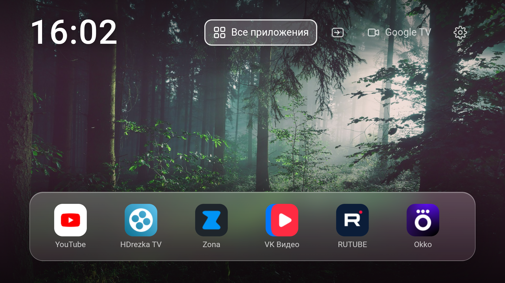

# TV Shell — лёгкий лаунчер для Android TV

[](https://github.com/aleksey19970506-png/Mi-TV-Light-Launcher/releases/latest)
[](LICENSE)
[](https://developer.android.com/about/versions/lollipop)
[](https://github.com/aleksey19970506-png/Mi-TV-Light-Launcher/releases/latest)

Минималистичная оболочка для Android TV, заменяющая тяжёлые штатные лаунчеры (PatchWall, Google TV) на быстрый экран с часами, плитками приложений и сменяющимися обоями.

Написана на HTML/CSS/JS внутри WebView, никаких сервисов и фоновых процессов: запустился → нарисовал → отдал память.



## Что умеет

- **Быстрый старт** — холодный запуск ~0.9 с на Xiaomi Mi TV P1 (Android 11).
- **Минимум памяти** — ~110 МБ PSS (это WebView), APK ~7 МБ.
- **Стеклянный интерфейс** в духе tvOS: полупрозрачная панель с размытием.
- **Часы** крупным шрифтом, обновление раз в 10 секунд.
- **Обои** — 13 фотографий в Full HD, смена каждые 20 секунд с плавным кроссфейдом. Предзагрузка только следующей картинки.
- **Плитки приложений** — все установленные приложения с родными иконками.
- **«Все приложения»** — сетка, удержание OK открывает меню: открыть / добавить на главный экран / убрать / удалить приложение.
- **Перемещение плиток** — «Переместить», дальше стрелками ← →, OK — готово. Порядок запоминается.
- **Входы** — кнопка открывает штатный селектор источников ТВ (HDMI и т.п.).
- **Настройки** — переход в системные настройки Android TV.
- **Google TV** — кнопка запуска штатного лаунчера, если он установлен.
- **Новые приложения** появляются в списке автоматически.
- Работает по пульту (D-pad + OK/Back), без мыши и тача.

## Требования

- Android TV / Google TV, **Android 5.0 (API 21)** и новее.
- Разрешение 1280×720 и выше.
- Любой пульт с D-pad.

## Установка

### 1. Включи отладку по ADB на телевизоре

- Настройки → О телевизоре → 7 раз нажать «Номер сборки» (включится режим разработчика).
- Настройки → Для разработчиков → **Отладка по USB / ADB** — включить.
- Настройки → Для разработчиков → **Отладка по сети** (Wi-Fi ADB) — включить, запомнить IP телевизора и порт (обычно 5555).

### 2. Подключись с компьютера

```bash
adb connect <YOUR_TV_IP>:5555
adb devices
```

При первом подключении на экране ТВ подтверди отпечаток ключа.

### 3. Установи APK

```bash
adb install -r TVShell.apk
```

Или скачай APK на ТВ и установи любым файловым менеджером (нужно разрешить установку из неизвестных источников).

### 4. Сделай оболочку домашним экраном (опционально)

```bash
# назначить домашним экраном
adb shell cmd package set-home-activity ru.tvshell.launcher/.MainActivity
```

Если штатный лаунчер всё равно перехватывает Home (у некоторых прошивок Xiaomi приоритет зашит), его нужно отключить, но тогда пропадёт доступ к его интерфейсу:

```bash
adb shell pm disable-user --user 0 com.google.android.tvlauncher
```

Вернуть как было:

```bash
adb shell pm enable --user 0 com.google.android.tvlauncher
```

## Сборка из исходников

Нужны: JDK 8+, Android SDK build-tools (aapt2, d8, zipalign, apksigner) и `android.jar` (например, из `platforms/android-30`).

```powershell
./build.ps1 -AndroidJar "C:\Android\sdk\platforms\android-30\android.jar" -BuildTools "C:\Android\sdk\build-tools\34.0.0"
```

Скрипт соберёт `TVShell.apk` в текущей папке. Ключ подписи: создаётся автоматически при первом запуске (`keystore.jks`, пароль `android`), либо передай свой: `-Keystore path.jks -StorePass ... -KeyPass ...`.

## Настройка под себя

- **Обои** — заменить файлы в `app/assets/bg*.jpg` (1920×1080, JPEG) и перечислить имена в массиве `WALLS` в `app/assets/index.html`.
- **Интервал смены** — параметр `20000` (мс) в функции `walls()` там же.
- **Размер/вид плиток** — CSS-переменные и правила `.tile`, `.dock` в `index.html`.
- **Статус-иконки в шапке** — разметка `<header>` в `index.html`.

## Известные ограничения

- HDMI-поток система не отдаёт сторонним приложениям: кнопка входов открывает штатный селектор источников, а не показывает видео внутри оболочки.
- Кнопка Google TV работает только если на ТВ установлен `com.google.android.tvlauncher`.
- У некоторых прошивок Xiaomi после перезагрузки сбрасываются назначенный домашний экран и настройки доступности — это поведение прошивки, не приложения.
- Перехват кнопки пульта (например, WWW/Explore) через AccessibilityService на части телевизоров замедляет обработку нажатий — поэтому в этой версии перехвата нет.

## Лицензия

MIT — см. [LICENSE](LICENSE).

## Disclaimer

All product names, logos, and brands are property of their respective owners. All company, product and service names used in this project are for identification purposes only. Use at your own risk.


